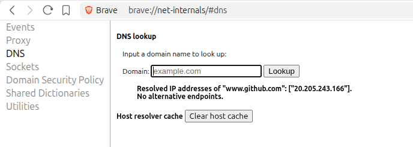
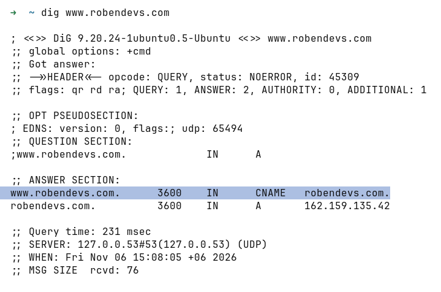
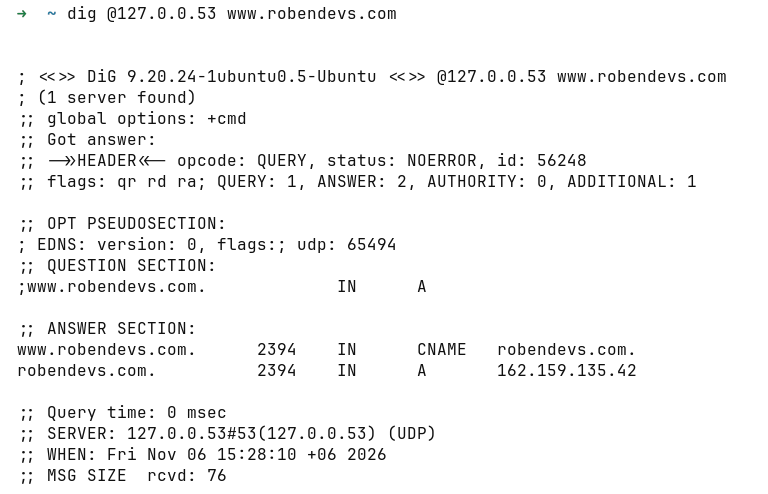

# Internet, networking, HTTP/HTTPS and browser internals
- Understanding the end-to-end request–response lifecycle, tracing a request from the user's browser (client side) to the server and back, including how the server processes the request and returns the corresponding response and how its being presented to the user.
- Helps to identify the spot where the application is breaking or we can have a vulnerability


1. Entering an URL in browser address bar
2. Is it a URL or a search term?
    - When no protocol or valid domain name is given the browser proceeds to send the text given in the address box to the browser's default web search engine. 
    - In many cases the url has a special piece of text appended to it to tell the search engine that it came from a particular browser's url bar.

    >> for example for I typed "arandomsearchterm" in my brave
    

3. If its an URL, it gets parsed
    ```
    https://example.com:443/index.html?id=5#section
    │        │          │      │        │     └ fragment 
    │        │          │      │        └ query string
    │        │          │      └ path
    │        │          └ port
    │        └ host
    └ scheme
    ```

4. Enforcing HTTPS

    The browser checks its "preloaded HSTS (HTTP Strict Transport Security)" list. This is a list of websites that have requested to be contacted via HTTPS only.
    If the website is in the list, the browser sends its request via HTTPS instead of HTTP. Otherwise, the initial request is sent via HTTP. (Note that a website can still use the HSTS policy without being in the HSTS list. The first HTTP request to the website by a user will receive a response requesting that the user only send HTTPS requests. However, this single HTTP request could potentially leave the user vulnerable to a downgrade attack, which is why the HSTS list is included in modern web browsers.)

5. Convert non-ASCII Unicode characters in hostname
    The browser checks the hostname for characters that are not in a-z, A-Z, 0-9, -, or ..
    Since the hostname is google.com there won't be any, but if there were the browser would apply Punycode encoding to the hostname portion of the URL.

6. Enterprise policies, parental controls, or extensions (like ad blockers) can block, redirect, or modify the request.

After all these local steps, network calls comes into picture starting with DNS lookup for the domain.


7. DNS Lookup
    Domain name is easy to be read by human, but under the hood, it has a corresponding IP address. The browser needs its IP address, such as 192.158.1.38., and build a connection with it.
- Looking up in caches first
    - Browser Cache : The browser looks at the browser cache for finding the domain name’s IP address. The browser caches the IP address we have visited recently, with setting a TTL (Time to live). [more on ttl](https://cleanbrowsing.org/learn/what-is-domain-ttl)
    
    TTL can diffrent values set by domain owner. but from user machine it can be seen using `dig` command 
    

    - OS Cache

        `systemd-resolved` runs a local DNS server on local machine at the loopback address `127.0.0.53`. If DNS tool is pointed specifically at that address, it will return the record out of the local cache, including the current counting-down TTL. 
        
    - Router cache

        Check the DNS cache in router. The router may have a DNS server by using ISP’s DNS server.

    - ISP Cache
        if the browser cannot find the website’s IP address in the process above, it continues to looks the cache in the DNS server of your ISP that provides Internet service to you. If the DNS server ISP doesn’t have the cache of the IP address, the ISP will start a DNS lookup for user.
- Recursive Resolver : If no local cache has the answer, your device sends the query to a recursive resolver, typically provided by your ISP or a public DNS service like Cloudflare (1.1.1.1) or Google (8.8.8.8). The recursive resolver does the heavy lifting. If it doesn't have the answer cached, it performs a queries.
    
    - Root Name Servers :
        The resolver first contacts one of the 13 root name server groups (labeled A through M). The root server doesn't know the IP of robendevs.com or any other whole domain, but it knows which servers are authoritative for .com and returns a referral.
    - TLD Name Servers :
        The resolver follows the referral to a .com TLD server. This server doesn't know IP either, but it knows which name servers are authoritative for robendevs.com and returns another referral.
    - Authoritative Name Server : 
        Finally, the resolver queries the authoritative name server for example.com. This server has the actual DNS records and returns the IP address (e.g., 93.184.216.34).

Just to know         
- Caching and TTL : Each DNS response includes a TTL (Time to Live) value that tells resolvers how long to cache the answer. 

- Recursive vs Iterative Queries
    - Recursive query: The client asks the resolver to do all the work and return the final answer
    - Iterative query: The resolver asks each server in the chain, receiving referrals to follow
    - Most client-to-resolver queries are recursive. Resolver-to-server queries are iterative.


- Record Types
DNS record types are instructions that live in authoritative DNS servers and provide information about a domain including what IP address is associated with that domain and how to handle requests for that domain.

| Record | What It Stores | Example |
|---|---|---|
| A | IPv4 address for a hostname | robendevs.com → 203.0.113.10 |
| AAAA | IPv6 address for a hostname | robendevs.com → 2001:db8::10 |
| CNAME | Alias pointing one hostname to another hostname | www.robendevs.com → robendevs.com |
| MX | Mail server hostname(s) for a domain, with priority values | Where @robendevs.com email goes |
| TXT | Arbitrary text, used for SPF, DKIM, domain verification, and more | SPF for email, domain ownership checks |
| NS | The authoritative nameservers for a domain | The domain's name servers |


