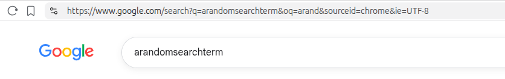
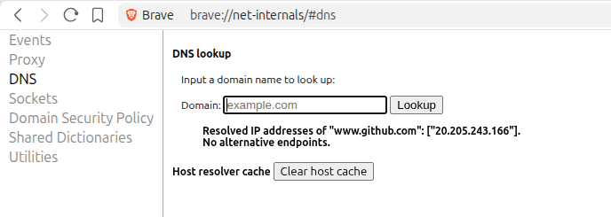
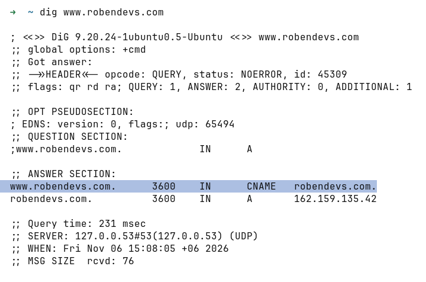
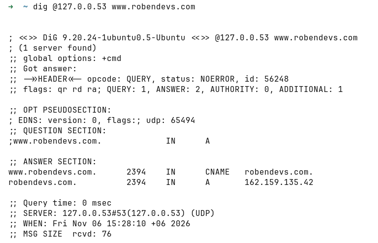
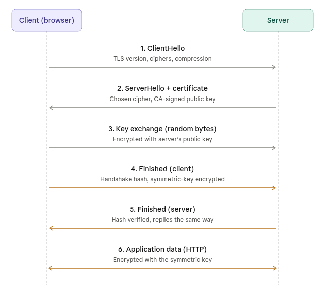
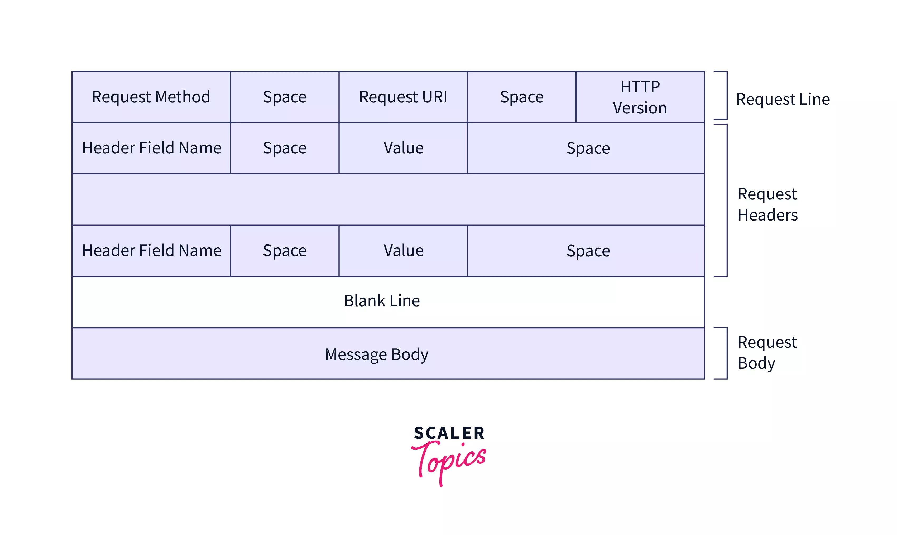

# Request Flow in Network
- Understanding the end-to-end request–response lifecycle, tracing a request from the user's browser (client side) to the server and back
- Helps to identify the spot where the application is breaking or we can have a vulnerability


1. Entering an URL in browser address bar
2. Is it a URL or a search term?
    - When no protocol or valid domain name is given the browser proceeds to send the text given in the address box to the browser's default web search engine. 
    - In many cases the url has a special piece of text appended to it to tell the search engine that it came from a particular browser's url bar.

    for example for I typed "arandomsearchterm" in my brave
    

3. If its an URL, it gets parsed
    ```
    https://example.com:443/index.html?id=5#section
    │        │          │      │        │     └ fragment 
    │        │          │      │        └ query string
    │        │          │      └ path
    │        │          └ port
    │        └ host
    └ scheme
    ```

4. Enforcing HTTPS

    The browser checks its "preloaded HSTS (HTTP Strict Transport Security)" list. This is a list of websites that have requested to be contacted via HTTPS only.
    If the website is in the list, the browser sends its request via HTTPS instead of HTTP. Otherwise, the initial request is sent via HTTP. (Note that a website can still use the HSTS policy without being in the HSTS list. The first HTTP request to the website by a user will receive a response requesting that the user only send HTTPS requests. However, this single HTTP request could potentially leave the user vulnerable to a downgrade attack, which is why the HSTS list is included in modern web browsers.)

5. Convert non-ASCII Unicode characters in hostname
    The browser checks the hostname for characters that are not in a-z, A-Z, 0-9, -, or ..
    Since the hostname is google.com there won't be any, but if there were the browser would apply Punycode encoding to the hostname portion of the URL.

6. Enterprise policies, parental controls, or extensions (like ad blockers) can block, redirect, or modify the request.

After all these local steps, network calls comes into picture starting with DNS lookup for the domain.


7. DNS Lookup
    Domain name is easy to be read by human, but under the hood, it has a corresponding IP address. The browser needs its IP address, such as 192.158.1.38., and build a connection with it.
- Looking up in caches first
    - Browser Cache : The browser looks at the browser cache for finding the domain name’s IP address. The browser caches the IP address we have visited recently, with setting a TTL (Time to live). [more on ttl](https://cleanbrowsing.org/learn/what-is-domain-ttl)
    
    TTL can diffrent values set by domain owner. but from user machine it can be seen using `dig` command 
    

    - OS Cache

        `systemd-resolved` runs a local DNS server on local machine at the loopback address `127.0.0.53`. If DNS tool is pointed specifically at that address, it will return the record out of the local cache, including the current counting-down TTL. 
        
    - Router cache

        Check the DNS cache in router. The router may have a DNS server by using ISP’s DNS server.

    - ISP Cache
        if the browser cannot find the website’s IP address in the process above, it continues to looks the cache in the DNS server of your ISP that provides Internet service to you. If the DNS server ISP doesn’t have the cache of the IP address, the ISP will start a DNS lookup for user.
- Recursive Resolver : If no local cache has the answer, your device sends the query to a recursive resolver, typically provided by your ISP or a public DNS service like Cloudflare (1.1.1.1) or Google (8.8.8.8). The recursive resolver does the heavy lifting. If it doesn't have the answer cached, it performs a queries.
    
    - Root Name Servers :
        The resolver first contacts one of the 13 root name server groups (labeled A through M). The root server doesn't know the IP of robendevs.com or any other whole domain, but it knows which servers are authoritative for .com and returns a referral.
    - TLD Name Servers :
        The resolver follows the referral to a .com TLD server. This server doesn't know IP either, but it knows which name servers are authoritative for robendevs.com and returns another referral.
    - Authoritative Name Server : 
        Finally, the resolver queries the authoritative name server for example.com. This server has the actual DNS records and returns the IP address (e.g., 93.184.216.34).

Just to know         
- Caching and TTL : Each DNS response includes a TTL (Time to Live) value that tells resolvers how long to cache the answer. 

- Recursive vs Iterative Queries
    - Recursive query: The client asks the resolver to do all the work and return the final answer
    - Iterative query: The resolver asks each server in the chain, receiving referrals to follow
    - Most client-to-resolver queries are recursive. Resolver-to-server queries are iterative.


- Record Types
DNS record types are instructions that live in authoritative DNS servers and provide information about a domain including what IP address is associated with that domain and how to handle requests for that domain.

| Record | What It Stores | Example |
|---|---|---|
| A | IPv4 address for a hostname | robendevs.com → 203.0.113.10 |
| AAAA | IPv6 address for a hostname | robendevs.com → 2001:db8::10 |
| CNAME | Alias pointing one hostname to another hostname | www.robendevs.com → robendevs.com |
| MX | Mail server hostname(s) for a domain, with priority values | Where @robendevs.com email goes |
| TXT | Arbitrary text, used for SPF, DKIM, domain verification, and more | SPF for email, domain ownership checks |
| NS | The authoritative nameservers for a domain | The domain's name servers |


At this point the client has resolved the ip-address and next work is establishment of TCP connection.


8. TCP Handshake with Retrieved IP address from DNS 
- Once the browser receives the IP address of the destination server, it takes that and the given port number from the URL (the HTTP protocol defaults to port 80, and HTTPS to port 443), and makes a call to the system library function named socket and requests a TCP socket stream - `AF_INET `and `SOCK_STREAM`.
- This request is first passed to the Transport Layer where a TCP segment is crafted. The destination port is added to the header, and a source port is chosen from within the kernel's dynamic port range.
- This segment is sent to the Network Layer, which wraps an additional IP header. The IP address of the destination server as well as that of the current machine is inserted to form a packet.
- The packet next arrives at the Link Layer. A frame header is added that includes the MAC address of the machine's NIC as well as the MAC address of the gateway (local router). 

here send and receive happens multiple times in this TCP Handshake.

* Client chooses an initial sequence number (ISN) and sends the packet to the
  server with the SYN bit set to indicate it is setting the ISN
* Server receives SYN and if it's in an agreeable mood:
   * Server chooses its own initial sequence number
   * Server sets SYN to indicate it is choosing its ISN
   * Server copies the (client ISN +1) to its ACK field and adds the ACK flag
     to indicate it is acknowledging receipt of the first packet
* Client acknowledges the connection by sending a packet:
   * Increases its own sequence number
   * Increases the receiver acknowledgment number
   * Sets ACK field
* Data is transferred as follows:
   * As one side sends N data bytes, it increases its SEQ by that number
   * When the other side acknowledges receipt of that packet (or a string of
     packets), it sends an ACK packet with the ACK value equal to the last
     received sequence from the other
* To close the connection:
   * The closer sends a FIN packet
   * The other sides ACKs the FIN packet and sends its own FIN
   * The closer acknowledges the other side's FIN with an ACK


9. TLS(Transport Layer Security) handshake
this happens between browser and by the certificate installed in server side.
* The client computer sends a ``ClientHello`` message to the server with its
  TLS version, list of cipher algorithms and compression methods available. It includes ALPN extension listing h2 and http/1.1 for server to decide.

* The server replies with a ``ServerHello`` message to the client with the
  TLS version, selected cipher, selected compression methods and the server's
  public certificate signed by a CA (Certificate Authority). It includes server's selected http protocol h2 or http/1.1 The certificate contains **a public key that will be used by the client to encrypt the rest of
  the handshake** until a symmetric key can be agreed upon.

* The client verifies the server digital certificate against its list of
  trusted CAs. If trust can be established based on the CA, the client
  generates a string of pseudo-random bytes and encrypts this with the server's
  public key. These random bytes can be used to determine the symmetric key.

* The server decrypts the random bytes using its private key and uses these
  bytes to generate its own copy of the symmetric master key.

* The client sends a ``Finished`` message to the server, encrypting a hash of
  the transmission up to this point with the symmetric key.

* The server generates its own hash, and then decrypts the client-sent hash
  to verify that it matches. If it does, it sends its own ``Finished`` message
  to the client, also encrypted with the symmetric key.

* From now on the TLS session transmits the application (HTTP) data encrypted
  with the agreed symmetric key.




application data after the handshake is the client’s encrypted HTTP request, for example GET / HTTP/1.1. The server decrypts it with the symmetric key and sends back the HTTP response, encrypted the same way.

10. HTTP Request Entering the server
HTTP version is decided on the TLS handshake.
references [rfc 9112](https://www.rfc-editor.org/info/rfc9112/)



- Start-Line (Request-Line or Status-Line)
- HTTP Headers (Zero or more key-value lines)
- Empty Line (A bare CRLF marking the end of metadata)
- Optional Body (The actual payload/data)

syntactically both remain almost same.


> This request gets parsed and processed in server. Application code process the request or reject based on different business logics. then sends the corresponding response back to client the same way.


11. Response back to client
- Response can be JSON or if its an server side rendered application then html. If JSON is sent then the conversion to html happens by any client side rendering technology like react (SPA).
- there are response codes can be sent meaning different things. [mdn response code doc](https://developer.mozilla.org/en-US/docs/Web/HTTP/Reference/Status)


