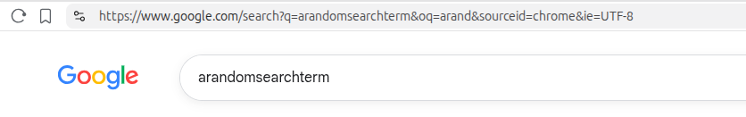

# Internet, networking, HTTP/HTTPS and browser internals
- Understanding the end-to-end request–response lifecycle, tracing a request from the user's browser (client side) to the server and back, including how the server processes the request and returns the corresponding response and how its being presented to the user.
- Helps to identify the spot where the application is breaking or we can have a vulnerability


1. Entering an URL in browser address bar
2. Is it a URL or a search term?
    - When no protocol or valid domain name is given the browser proceeds to send the text given in the address box to the browser's default web search engine. 
    - In many cases the url has a special piece of text appended to it to tell the search engine that it came from a particular browser's url bar.

    >> for example for I typed "arandomsearchterm" in my brave
    

3. If its an URL, it gets parsed
    ```
    https://example.com:443/index.html?id=5#section
    │        │          │      │        │     └ fragment 
    │        │          │      │        └ query string
    │        │          │      └ path
    │        │          └ port
    │        └ host
    └ scheme
    ```

4. Enforcing HTTPS

    The browser checks its "preloaded HSTS (HTTP Strict Transport Security)" list. This is a list of websites that have requested to be contacted via HTTPS only.
    If the website is in the list, the browser sends its request via HTTPS instead of HTTP. Otherwise, the initial request is sent via HTTP. (Note that a website can still use the HSTS policy without being in the HSTS list. The first HTTP request to the website by a user will receive a response requesting that the user only send HTTPS requests. However, this single HTTP request could potentially leave the user vulnerable to a downgrade attack, which is why the HSTS list is included in modern web browsers.)

5. Convert non-ASCII Unicode characters in hostname
    The browser checks the hostname for characters that are not in a-z, A-Z, 0-9, -, or ..
    Since the hostname is google.com there won't be any, but if there were the browser would apply Punycode encoding to the hostname portion of the URL.

6. Enterprise policies, parental controls, or extensions (like ad blockers) can block, redirect, or modify the request.

After all these local steps, network calls comes into picture starting with DNS lookup for the domain.


