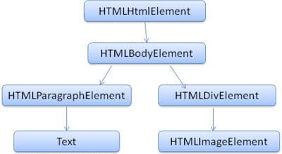
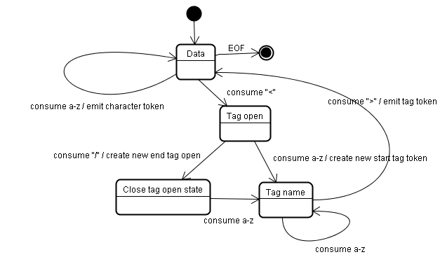
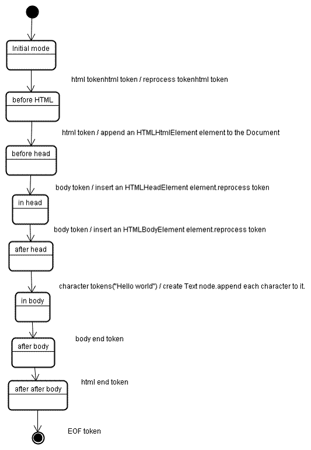
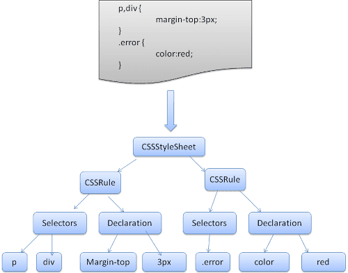
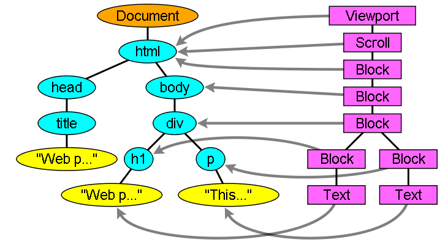

* Once connection is established with a web server and browser receives response from server as HTML(keeping spa application aside), the browser's rendering process starts.

* TCP layer handles the flow of data that is being received in client side. TCP splits data into segments for reliable delivery and sends ACK packet to server. The receive window (RWND) protects the client by telling server how much incoming data the client is currently prepared to accept and the congestion window (CWND) protects the network by estimating how much data the path to the client can carry without segments being dropped.

* Once the browser receives the first chunk of data (8kb ~ 14kb), it starts parsing it to DOM and CSSOM which is used by renderer to paint a page to the screen. DOM is the browser's internal representation of the markup. DOM is also exposed and can be manipulated through various JS api.


HTML 5 References
-----
* https://html.spec.whatwg.org/multipage/parsing.html#parsing

Building the DOM Tree
-----

The first step is processing the HTML data and building the DOM tree. 
a html markup 
    ```html
    <html>
      <body>
        <p>
          Hello World
        </p>
        <div> </div>
      </body>
    </html>
    ```
    gets converted to a DOM tree like this
    

HTML cannot be parsed using the regular top down or bottom up parsers.
The reasons are:
* The forgiving nature of the language.
* The fact that browsers have traditional error tolerance to support well known cases of invalid HTML.
* The parsing process is reentrant. For other languages, the source doesn't change during parsing, but in HTML, dynamic code (such as script elements containing document.write() calls) can add extra tokens, so the parsing process actually modifies the input.


Parsing Algorithm has 2 stages
* Tokenization : Output is HTML Token. Its a state machine. It converts html data to its html tokens. for example
    * a start tag (<body>)
    * an end tag (</body>)
    * text characters (Hello world)
  [algorithm in details](https://web.dev/articles/howbrowserswork#the_tokenization_algorithm) 
  

* Tree Construction :  Each node emitted by the tokenizer will be processed by the tree constructor. For each token the specification defines which DOM element is relevant to it and will be created for this token. The element is added to the DOM tree, and also the stack of open elements. This stack is used to correct nesting mismatches and unclosed tags.
    [algorithm in details](https://web.dev/articles/howbrowserswork#tree_construction_algorithm)
    


These doesn't block the parser in its working process.
  * async & deferred js script
  * font, images, media
  * non-render blocking css, stylesheets that include media attribute

Preload scanners
--------

* Building the DOM tree occupies the main thread. The preload scanner parses the available content and requests high-priority resources like CSS, JavaScript, and web fonts.It retrieves resources in the background so that, by the time the main HTML parser reaches the requested assets, they may already be in downloaded or downloading, so not the parsing is not blocked.

```html
<link rel="stylesheet" href="styles.css" />
<script src="my-script.js" async></script>

<script src="another-script.js" async></script>
```
In this example, while the main thread parses the HTML and CSS, the preload scanner finds the scripts and image and starts downloading them as well. The async attribute ensures the script doesn't block the process. This can be swapped out for the defer attribute if JavaScript parsing and execution order is important.

Waiting to obtain CSS doesn't block HTML parsing or downloading, but it does block JavaScript because scripts are often used to query CSS properties' impact on elements.


Building the CSSOM tree
-----

* CSSOM is also tree like data structure. browser converts CSS rules into a style map, this includes a tree of nodes with parent, child and sibling relationships based on the CSS selectors.

* WebKit uses Flex and Bison parser generators to create parsers automatically from the CSS grammar files. As you recall from the parser introduction, Bison creates a bottom up shift-reduce parser. Firefox uses a top down parser written manually.  


* In both cases each CSS file is parsed into a StyleSheet object. Each object contains CSS rules. The CSS rule objects contain selector and declaration objects and other objects corresponding to CSS grammar. 


* CSS is render blocking: the browser blocks page rendering until it receives and processes all the CSS. But building the CSSOM is fast and is not displayed in the developer tools. Rather, the "Recalculate Style" metric in developer tools shows the total time it takes to parse CSS, construct the CSSOM tree, and recursively calculate computed styles. Creating the CSSOM generally takes less time than one DNS lookup.


Render Tree
----

* While the DOM tree is being constructed, the browser constructs another tree, the render tree. This tree is of visual elements in the order in which they will be displayed. It is the visual representation of the document. The purpose of this tree is to enable painting the contents in their correct order. Firefox calls the elements in the render tree "frames". WebKit uses the term "renderer" or render object.


* The renderers correspond to DOM elements, but the relation is not one to one. Non-visual DOM elements won't be inserted in the render tree. An example is the "head" element. Also elements whose display value was assigned to "none" won't appear in the tree (whereas elements with "hidden" visibility will appear in the tree). 


Layout 
----

* Layout is the process by which the dimensions and location of all the nodes in the render tree are determined.

* To determine the exact size and position of each object, the browser starts at the root of the render tree and traverses it.

* The first time the size and position of each node is determined is called layout. Subsequent recalculations of layout are called reflows. In our example, suppose the initial layout occurs before the image is returned. Since we didn't declare the image dimensions, there will be a reflow once the dimensions are known.


