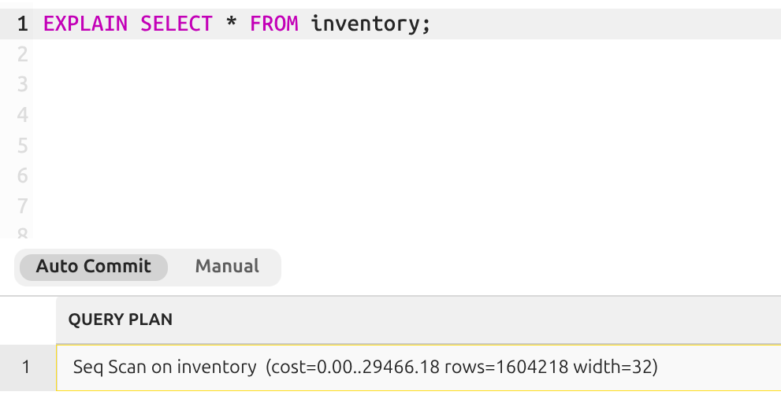

# postgresql-explain-analyze

- `EXPLAIN` shows the plan PostgreSQL expects to run.
- `EXPLAIN ANALYZE` runs the statement and adds measured rows, loops, and timing.
- Sequential Scan just row by row scan

This database’s `inventory` table has 1604218 rows

format of the result of `EXPLAIN` keyword

`cost=startup..total rows=x width=y` 

- **startup :** estimated time needed for the work done before the node can output its very first row. it gets higher for queries that has more startup work such as `ORDER_BY` , `AGGREGATE`
- **total:** estimated time for running the query.
- **rows :**  total rows that query scanned
- **width :** estimated average size, in bytes, of each row output

Normally sorting the payment table rows based on amount column in descending order.

so this query sorts rows of payment table by amount. it has a startup time. it first did seq scan for 140 ms (around), for this it scanned around 1.42 million rows and then it returns the rows to be sorted and there its sorted